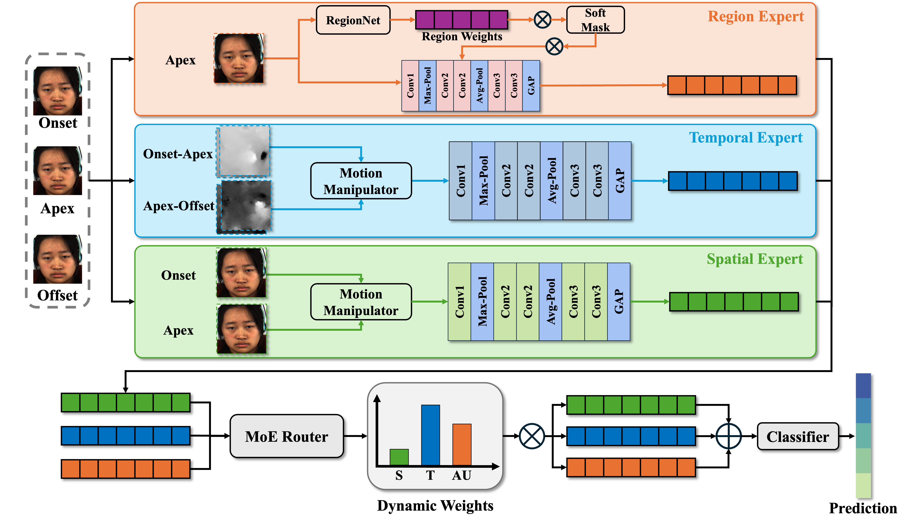

# RA-MoE: Region-Aware Mixture-of-Experts for AU-Guided Micro-expression Recognition

Official PyTorch implementation of **RA-MoE: Region-Aware Mixture-of-Experts for AU-Guided Micro-expression Recognition**, prepared for the ECML-PKDD 2026 paper release.

RA-MoE uses three effective branches:

- `S`: global static appearance.
- `T`: optical-flow temporal motion.
- `AU`: RegionNet-guided regional cues
